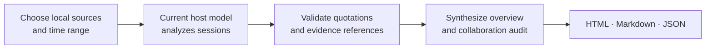

<div align="center">

# Agent Insight

### Turn agent conversations into better collaboration.

Evidence-backed retrospectives for Claude Code · Codex · Cursor · OpenCode · Pi

[](https://nodejs.org/)
[](package.json)

**[Quick start](#quick-start)** · **[What you get](#what-you-get)** · **[How it works](#how-it-works)** · **[Detailed guide](docs/guide.md)**

</div>

---

Agent Insight reads your local coding-agent history and turns it into one report: what you worked on, what helped, where collaboration broke down, and what to try next.

Use the model already selected in your current agent to analyze history from any supported source. For example, run it in Codex to review Claude Code sessions. No hidden provider switch or nested agent CLI.

> **The goal:** useful changes grounded in actual conversations. Keep effective habits, distinguish agent failures from user mistakes, and recommend no change when the evidence does not justify one.

## What you get

| In your report | What it helps you understand |
| --- | --- |
| **Work overview** | Projects, goals, tools, languages, outcomes, and session patterns. |
| **Collaboration review** | Supported friction, effective habits, and the context behind corrections or changes of direction. |
| **Practical next steps** | Priority findings, copyable prompts, and one evidence-supported improvement when justified. |
| **Automation candidates** | Repeated requests that may be worth turning into a Skill, command, or template. |
| **Inspectable evidence** | Quotations and session/message references, with links to retained evidence. |
| **Coverage and limitations** | What was read, what was missing, and which analysis sections failed. |

Each semantic run produces **HTML**, **Markdown**, and **JSON**. The HTML is for browsing; Markdown preserves the findings and evidence for reading or agent handoff; JSON retains structured results.

The overview follows a fixture-tested Claude `/insights` compatibility profile, extended with cross-agent analysis and a user-focused audit. This is an independent project, not official Claude certification, and it does not replace Claude’s built-in `/insights`.

## Quick start

Requires **Node.js 20+** and at least one supported coding agent.

```bash
git clone https://github.com/tt-a1i/agent-insight.git
cd agent-insight
npm link
agent-insight doctor

# Install into your current project; choose your host agent.
agent-insight install --agent codex --scope project
```

Invoke the installed command in that agent:

| Host | Command | Installation name |
| --- | --- | --- |
| Codex | `$agent-insights` | `codex` |
| Claude Code | `/agent-insights` | `claude` |
| Cursor | `/agent-insights` | `cursor` |
| OpenCode | `/agent-insights` | `opencode` |
| Pi | `/agent-insights` | `pi` |

Every invocation asks which sources and time range to analyze. Pi requires `/reload` or a restart after installation. If Pi is busy, analysis is queued as a follow-up; the displayed run ID confirms preparation, not a finished report.

**Default language:** Simplified Chinese. Use `--locale en` for English. On the Claude host, the compatibility report shell remains English regardless of locale.

**Semantic reports:** `~/.agent-insight/usage-data/`

<details>
<summary><strong>Installation scope and command availability</strong></summary>

Use `--scope project` for the current project. User-wide installation (`--scope user`) is supported for Claude Code, Codex, OpenCode, and Pi; Cursor commands are project-scoped. Existing files are protected unless `--force` is explicitly enabled.

The `agent-insight` executable must be on the invoking agent’s `PATH`. If the command is missing, run `npm link` in this repository and check npm’s global binary path.

</details>

## How it works



**Host, model, and source are separate.** The host runs analysis with its selected model. The source supplies readable local session history; its agent does not need to be logged in or running. Cursor support is experimental, and OpenCode’s public session listing covers root sessions.

Long sessions and large aggregates are processed in bounded chunks. Completed tasks are checkpointed so an interrupted run can resume with the same host/model identity. Unrecoverable sections remain visibly unavailable while completed sections stay usable.

## Evidence you can inspect

- **Quotes are checked against their cited messages.** Assistant text, tool results, and recognized system injections cannot serve as user-authored evidence.
- **Context matters.** Analysis retains counterevidence, justified changes, and effective corrections; tool failures are not automatically user mistakes.
- **No quota of problems.** A successful or sparse session may yield no findings or prescribed change. Effective habits are preserved independently.
- **Counts have boundaries.** Project-area counts are labeled model estimates and bounded by analyzed sessions. Missing usage and context metrics stay unknown; partial totals disclose coverage.
- **References establish provenance.** They do not prove the model’s interpretation or a causal claim. Repeated patterns need distinct supporting messages; a single session cannot establish a cross-session habit.

Automation suggestions are advisory. Generating a report does not create Skills, commands, automations, or change host configuration.

> **Before sharing:** semantic reports can contain user quotations, absolute project paths, agent identities, dates, and session IDs. Selected transcript text is sent to your invoking host model under that host/provider’s policies. Complete transcripts and tool payloads are not copied into reports.

## Local metadata without model analysis

For a deterministic report that does not call an LLM:

```bash
agent-insight report --source codex,claude --days 30
open ~/.agent-insight/latest/report.html
```

This mode summarizes local metadata. It cannot establish intent, satisfaction, or code quality. Add `--project /path/to/repo` to scope a report; time filters select whole sessions by their last recorded activity.

## Documentation

| Guide | Contents |
| --- | --- |
| [Detailed usage guide](docs/guide.md) | Sources, installation, CLI workflow, imports, evidence policy, recovery, and troubleshooting. |
| [Compatibility contract](docs/parity/claude-2.1.206.md) | Claude Code 2.1.206 baseline and intentional extensions. |
| [Validation and evaluation](docs/parity/acceptance.md) | Regression evidence, optional comparison tooling, and validation limits. |

## Development

```bash
npm test
npm run check
```

Tests cover source parsing, scope and coverage, authorship, evidence binding, chunk budgets, resumable execution, concurrent writes, report recovery, CLI behavior, and installation safety. Controlled tests and model examples do not certify every real-world judgment or every host’s UI integration.

License: MIT (declared in [package.json](package.json)).
